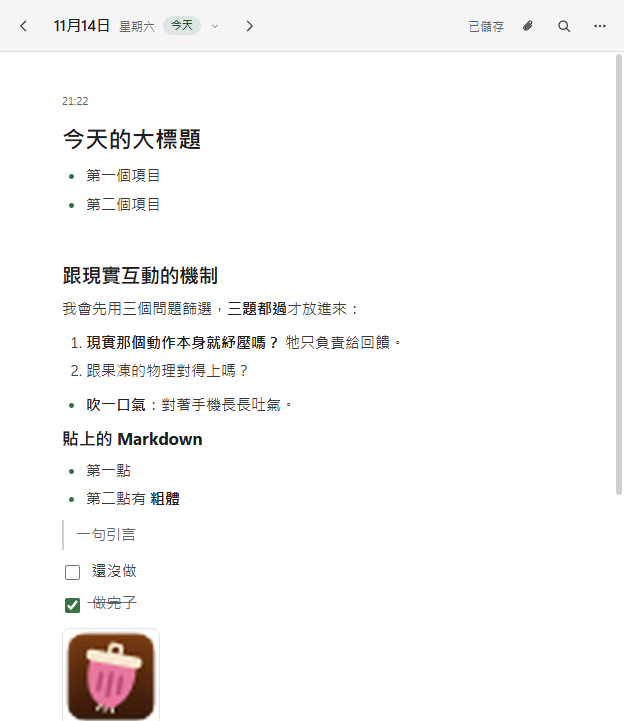
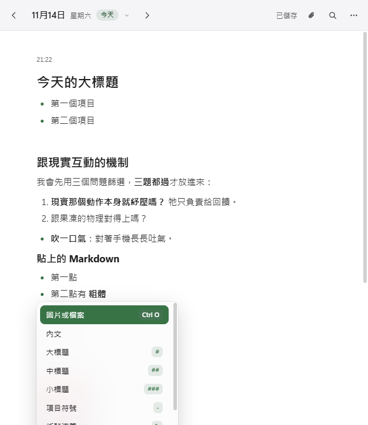
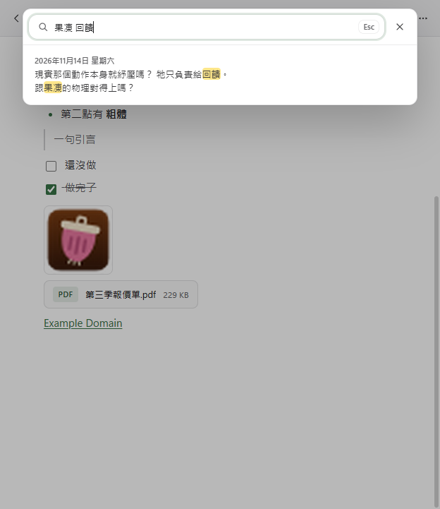
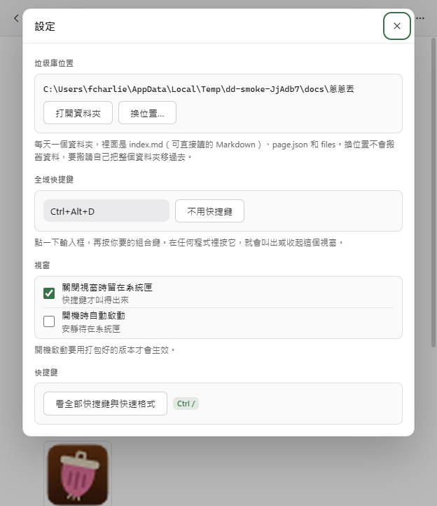
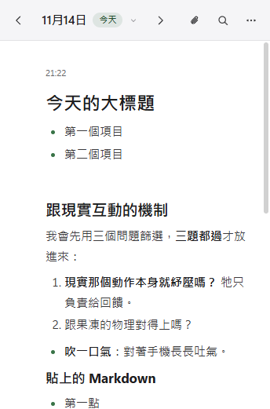

<p align="center"></p>

# 蔥蔥丟

寫作時的剪下暫存區：每天一頁，把剪掉的段落先丟進來，幾天內要用再撈回去。（原名 Daily Dump、蔥頭）

改稿時剪掉一段，又怕之後用得到，就先丟進今天那一頁。寫到一半需要時，再找出來貼回去。超過三天的頁面大多不會再打開，所以它長得很簡單：打開就是今天這一頁，游標已經在最後面等你貼。



## 怎麼用

### 丟進來

每一天是一頁文件，直接在頁面裡打字和貼上。內容自動存，不用按存檔，頂列右邊會顯示「已儲存」。

- 貼上會保留格式：標題、項目符號、粗體、表格。貼 Markdown 純文字也會變成格式。
- Ctrl+V 貼截圖或從檔案總管複製的檔案；也可以把檔案拖進頁面。圖片直接顯示，其他檔案顯示成一塊，點兩下打開（或選到之後按 Enter）。
- 只貼一個網址會自動換成網頁標題。
- 今天這一頁隔 10 分鐘以上再丟東西，會自動加一條時間線，看得出哪些是同一批丟的。
- 全域快捷鍵預設 Ctrl+Alt+D：在任何程式裡叫出或收起視窗（可在設定裡改）。丟完按 Esc 就收起來。

### 放圖片和檔案

在頁面裡打 `/`，選單第一項就是「圖片或檔案」，所以打 `/` 再按 Enter 就會開選檔視窗。頂列的迴紋針、Ctrl+O、拖放、貼上也都可以。



同一個選單裡還有格式：內文、三種標題、項目符號、編號清單、待辦勾選、引言、程式碼區塊、分隔線、粗體、斜體、刪除線、插入現在時間。打 `/` 之後繼續打字可以篩選。

習慣 Markdown 的話直接打也行：`# 空格` 變標題、`- 空格` 變項目符號、`1. 空格` 變編號、`[ ] 空格` 變待辦、`> 空格` 變引言。

### 撈回去

滑鼠移到某一塊，左邊會出現兩顆小按鈕：「複製整塊」和抓手。不想碰滑鼠就按 Ctrl+Shift+C，會複製游標所在的那一整塊，格式一起帶走。

抓手可以拖曳搬動，放開會落在綠線的位置。Alt+↑、Alt+↓ 也能搬。


### 找以前丟的

Ctrl+F 會搜尋所有日子，多個字用空格分開。點結果會跳到那一天。



換日子用頂列左邊那一組：左右箭頭是前一天、後一天，點日期開月曆（有東西的日子下面有一個小點）。不在今天時，旁邊會出現「回今天」。

### 設定

右上角「⋯」裡有格式、複製這一塊、快捷鍵一覽、設定。



- 關閉視窗預設會留在系統匣；要真的結束，對系統匣圖示按右鍵選「結束」。
- 開機啟動預設是關的，而且要用打包好的版本才會生效。

### 視窗可以很窄

最小寬度 340，可以跟稿子並排一格。



## 快捷鍵

在 app 裡按 Ctrl+/ 可以看同一張表。

| 按鍵 | 做什麼 |
|---|---|
| Ctrl+Alt+D | 在任何程式裡叫出或收起視窗（可改） |
| Ctrl+V | 貼上文字、網址、截圖、檔案 |
| Ctrl+Shift+V | 貼成純文字 |
| Ctrl+O | 選檔案放進這一頁 |
| `/` | 叫出選單：放圖片或檔案、換格式 |
| Ctrl+Shift+C | 複製游標所在的整塊 |
| Enter | 選到檔案或圖片時打開它 |
| Alt+↑、Alt+↓ | 把這一塊往上、往下搬 |
| Alt+T | 插入現在時間 |
| Ctrl+F | 搜尋所有日子 |
| Alt+←、Alt+→ | 前一天、後一天 |
| Ctrl+T | 回到今天 |
| Ctrl+G | 月曆（方向鍵選日子，PageUp、PageDown 換月） |
| Ctrl+, | 設定 |
| Ctrl+/ | 快捷鍵一覽 |
| Esc | 關掉面板；沒有面板時收起視窗 |

## 資料放哪

預設在「文件\蔥蔥丟」。以前用過舊版的話，「文件\DailyDump」或「文件\蔥頭」還在就接著用，不會搬也不會改名。可在設定裡換位置。

```
蔥蔥丟/
  2026/
    2026-11-14/
      page.json      編輯器的正本
      index.md       可直接讀的 Markdown 副本，每次變動自動重寫
      files/         丟進來的檔案（複製一份）
```

`index.md` 是純文字，用任何編輯器都打得開，哪天不用蔥蔥丟了資料也還讀得到。

從頁面上刪掉圖片或檔案時，`files` 裡的那份不會跟著刪。換垃圾庫位置不會搬舊資料，要搬請自己把整個資料夾移過去。

## 安裝

### Windows

```
npm install
npm run pack:win
```

打包好的程式在 `dist/蔥蔥丟-win32-x64/`，執行裡面的 `蔥蔥丟.exe`。整個資料夾可以搬到別的地方，不用安裝。

### Mac

Mac 版要在 Mac 上打包（在 Windows 上打包出來的 `.app` 會壞掉）。這個 repo 有一支 GitHub Actions 幫忙做：到 Actions 頁籤選「打包」，按 Run workflow，跑完在那一次執行的頁面最下面下載 `mac` 壓縮檔。裡面有兩個版本：

- `蔥蔥丟-darwin-arm64.zip`：M 系列晶片的 Mac
- `蔥蔥丟-darwin-x64.zip`：Intel 的 Mac

自己有 Mac 的話，直接跑 `npm install` 和 `npm run pack:mac` 也可以。

這個 app 沒有 Apple 開發者簽章，第一次打開 macOS 會擋。對 `蔥蔥丟.app` 按右鍵選「打開」，再按一次「打開」。還是打不開就在終端機跑：

```
xattr -cr /Applications/蔥蔥丟.app
```

Mac 版目前只確認打包得出來，沒有在 Mac 上實際用過。系統匣、全域快捷鍵、開機啟動在 Mac 上的行為還沒驗。

## 開發

```
npm install
npm start        # 打包介面後執行
npm test         # 儲存層檢查
npm run web      # 產生網頁版，並更新 docs/index.html（GitHub Pages 用）
npm run icons    # 從 assets/icon.svg 重新產生 icon.png、tray.png、icon.ico、icon.icns
npm run pack:win # 打包 Windows 版到 dist/
npm run pack:mac # 打包 Mac 版到 dist/（要在 Mac 上跑）
```

整個 app 跑一輪並截圖（本頁的附圖就是這樣拍的，用的是暫存資料夾，不會碰你的垃圾庫）：

```
npx electron scripts/smoke.js
```

截圖會存到 `shots/`。

### 檔案在哪

```
src/
  main.js              主程序：視窗、系統匣、全域快捷鍵、選檔、設定
  preload.js           主程序與頁面之間的橋
  store.js             讀寫垃圾庫（page.json、index.md、files）
  renderer/
    index.html         頁面骨架
    app.src.js         介面程式（Tiptap 編輯器）；打包成 app.js
    app.css            介面樣式
    theme.css          產品色「蔥綠」
  design/
    domy-desktop.css   借來的設計代號
assets/                圖示（icon.svg 是來源，其他由 npm run icons 產生）
scripts/               測試、冒煙測試、網頁版、圖示
web/                   網頁預覽版用的替身（用瀏覽器儲存空間代替資料夾）
docs/                  GitHub Pages 的網頁預覽版，還有這一頁的附圖
.uiux-win/             設計紀錄：核心動作卡、審查紀錄、閘門紀錄
```

## 介面的規矩

介面借用 Domy 桌面設計系統的代號：`src/design/domy-desktop.css` 是從 `E:\domy-design` 複製來的一份，不要手改。`src/renderer/app.css` 裡的顏色、字級、間距、圓角、陰影、動畫時間都只寫代號；真的只用一次的值，在那一行寫「例外:原因」。產品色蔥綠是蔥蔥丟自己的，放在 `src/renderer/theme.css`，不放回 domy-design。
